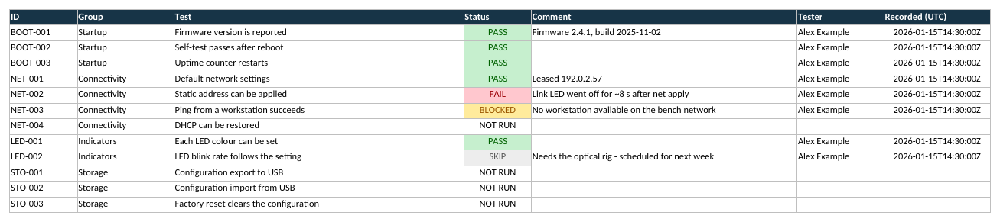
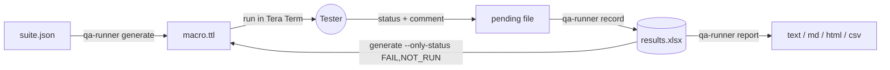
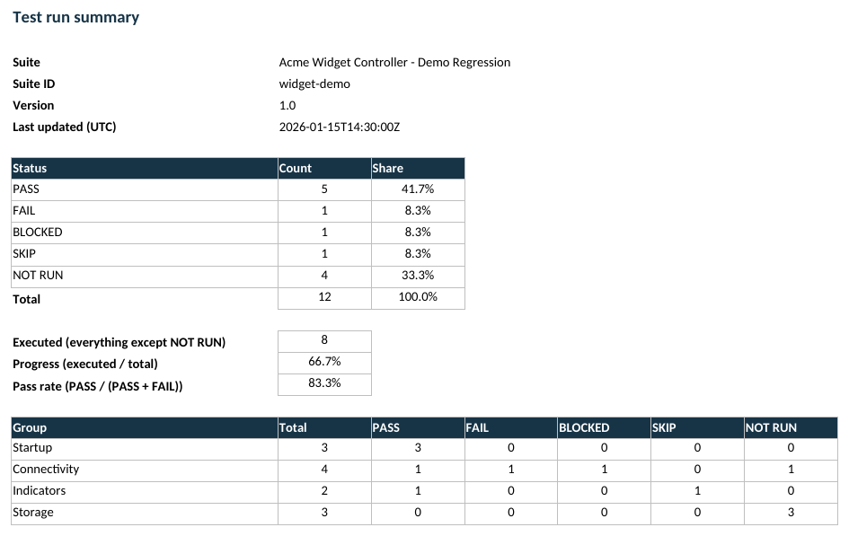

# teraterm-qa-runner

[](https://github.com/TaqdeerK22/teraterm-qa-runner/actions/workflows/ci.yml)


[](LICENSE)

**Run guided manual test campaigns from [Tera Term](https://teratermproject.github.io/) and have every
result land in an Excel workbook the moment you enter it.**

You describe your tests once in a small JSON file. The tool generates a Tera Term macro that walks the
tester through each test (what to click, which command to send to the device, what to verify), asks
for PASS / FAIL / BLOCKED / SKIP, takes a comment, and saves the outcome - with tester name and UTC
timestamp - straight into a colour-coded workbook with a live summary sheet.



## Why

Manual hardware and embedded testing usually means a test script in a document, a serial terminal
on the side, and results typed into a spreadsheet afterwards (or lost when the session crashes).
This project closes that gap:

- **Nothing is lost.** Each result is saved immediately and atomically. A crash at test 40 still
  leaves tests 1-39 in the workbook.
- **One source of truth.** Tests live in a reviewable JSON file; the macro is generated, never
  hand-maintained.
- **Zero installs beyond Python.** Standard library only - the `.xlsx` file is written by hand,
  so it works on locked-down lab PCs.
- **Repeat only what matters.** Generate a macro for just the failed or not-yet-run tests.

## How it works



The macro language (TTL) cannot write Excel files, so the macro hands each result to Python through
a tiny text file; Python merges it into the workbook and deletes the file. If the file is still
there afterwards, the macro knows the save failed and stops. Details: [docs/ARCHITECTURE.md](docs/ARCHITECTURE.md).

## Quick start (Windows)

Requirements: Windows, [Tera Term](https://teratermproject.github.io/) 4.106+ or 5.x, Python 3.9+.

```bat
git clone https://github.com/TaqdeerK22/teraterm-qa-runner
cd teraterm-qa-runner
py -3 -m pip install -e .

py -3 -m qa_runner validate suites\demo_suite.json
py -3 -m qa_runner generate suites\demo_suite.json -o macros\demo_suite.ttl
```

1. Open Tera Term and connect to your device (a serial loopback is fine for a dry run).
2. **Control > Macro...** and pick `macros\demo_suite.ttl`.
3. Follow the prompts. Results go to `%USERPROFILE%\qa_results\widget-demo_results.xlsx`.

```bat
py -3 -m qa_runner report suites\demo_suite.json %USERPROFILE%\qa_results\widget-demo_results.xlsx
py -3 -m qa_runner report suites\demo_suite.json %USERPROFILE%\qa_results\widget-demo_results.xlsx --format html -o report.html
```

The demo suite targets a fictional "Acme Widget Controller". Copy it and replace the tests with
yours. Ready-made outputs are in [`examples/`](examples/): the generated macro, a sample workbook
and reports.

### The Summary sheet



Counts, progress and pass rate are live Excel formulas, so they keep working if you edit statuses by hand.

## Writing a suite

```json
{
  "schema": 1,
  "id": "widget-demo",
  "name": "Acme Widget Controller - Demo Regression",
  "version": "1.0",
  "setup": [
    { "send_secret": "login admin {secret}", "prompt": "Device admin password" }
  ],
  "tests": [
    {
      "id": "NET-002", "group": "Connectivity", "title": "Static address can be applied",
      "steps": [
        { "send": "net set ip 192.0.2.10 255.255.255.0" },
        { "send": "net apply", "wait_after": 5 },
        { "instruct": "Look at the link LED." }
      ],
      "verify": "Verify the controller reports 192.0.2.10 and the link LED stays on."
    }
  ],
  "teardown": [ { "send": "logout" } ]
}
```

| Step | Meaning |
|---|---|
| `{"instruct": "..."}` | Pop-up telling the tester what to do by hand |
| `{"send": "cmd", "wait_after": 2}` | Type a command into the session, then pause |
| `{"send_secret": "login admin {secret}"}` | Like `send`, but the secret comes from a masked password box and is never stored |
| `{"wait": 15}` | Pause (seconds) |

Full reference with all rules and limits: [docs/SUITE_FORMAT.md](docs/SUITE_FORMAT.md).
`qa-runner validate` lists *every* problem in one pass.

## Command reference

| Command | Purpose |
|---|---|
| `validate SUITE` | Check a suite; report all problems |
| `generate SUITE -o OUT.ttl` | Generate the macro. Options: `--ids`, `--group`, `--from ID`, `--results BOOK --only-status FAIL,NOT_RUN`, `--python CMD`, `--results-dir-name NAME` |
| `init SUITE BOOK` | Create an empty workbook (everything NOT RUN) |
| `report SUITE BOOK` | Summarize: `--format text\|md\|html\|csv`, `-o FILE`, `--fail-on-fail` |
| `record SUITE PENDING BOOK` | Used by the macro to save one result |

Re-run what is left or broken:

```bat
py -3 -m qa_runner generate suites\demo_suite.json -o macros\rerun.ttl ^
    --results %USERPROFILE%\qa_results\widget-demo_results.xlsx --only-status FAIL,NOT_RUN
```

## Project layout

```
src/qa_runner/   model.py    statuses and Result (single source of truth)
                 suite.py    load + validate suites, select tests
                 ttl.py      macro generator and linter
                 xlsx.py     dependency-free XLSX writer/reader
                 results.py  pending file -> workbook row (atomic, with retry)
                 report.py   text / Markdown / HTML / CSV summaries
                 cli.py      command-line interface
suites/          demo_suite.json (fictional device)
examples/        generated macro, workbook and reports (kept current by CI)
tests/           86 unit tests (stdlib unittest)
docs/            architecture, suite format, macro verification checklist
```

## Verification status

| Layer | How it is verified |
|---|---|
| Suite parsing, workbook, reports, CLI | 86 unit tests; CI on Linux, Windows, macOS x Python 3.9-3.13 |
| Workbook opens in Excel-compatible software | Rendered with LibreOffice; read back with openpyxl when installed |
| Generated macro - **structure** | Linted on every generation (balanced `if`/`endif`, labels, quoting, one `qa_id` per `call`) |
| Generated macro - **behaviour in Tera Term** | **Manual**: see [docs/TESTING_THE_MACRO.md](docs/TESTING_THE_MACRO.md). Verified with Tera Term version:Tera Term version: 5.7.0 x64|

Unit tests cannot execute TTL. If you find a difference between Tera Term versions, please open an issue.

## Limitations

- The macro half needs Windows and Tera Term; the Python half runs anywhere.
- Text that ends up in the macro (titles, instructions, commands) is limited to printable ASCII and
  250 characters per string. Group names, comments and tester names in Excel can be any text.
- `--python` must not contain spaces unless you use a short path (the command line is passed to `cmd /c`).
- The workbook is regenerated on every save: manual cell formatting is not preserved; statuses,
  comments, tester and timestamps are.

## Contributing

Pull requests are welcome - see [CONTRIBUTING.md](CONTRIBUTING.md). Security notes: [SECURITY.md](SECURITY.md).

## License

[MIT](LICENSE)
